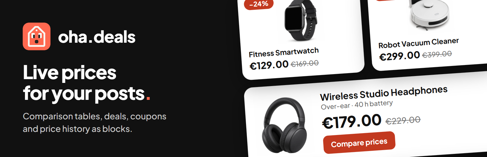
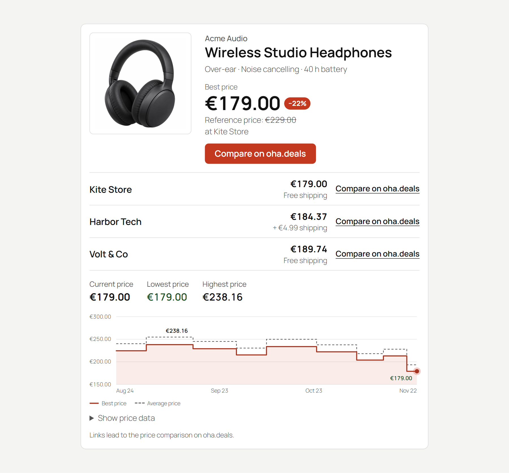
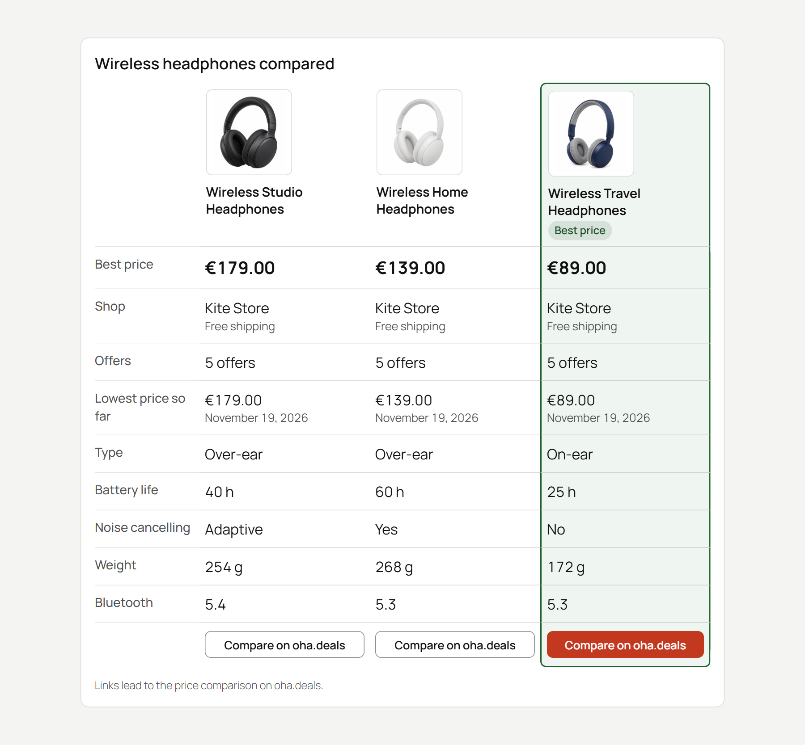
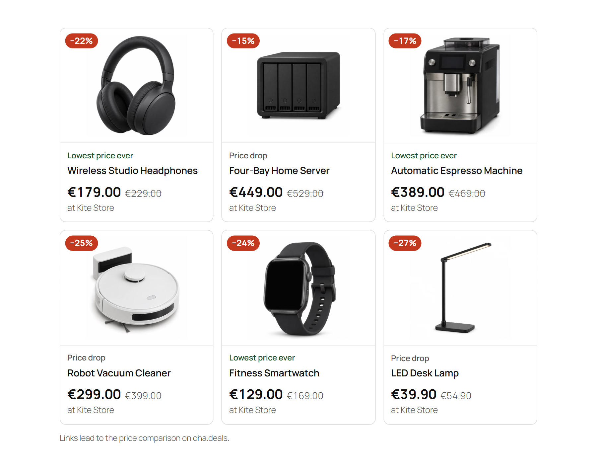
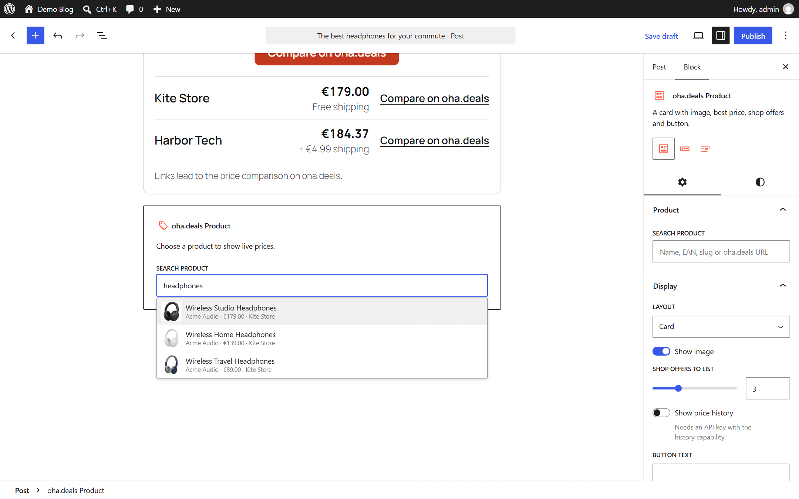
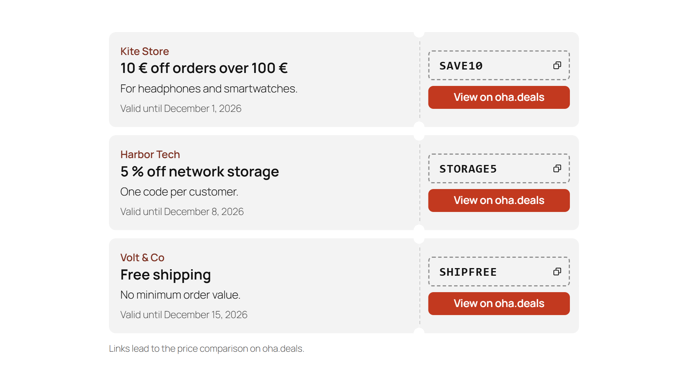
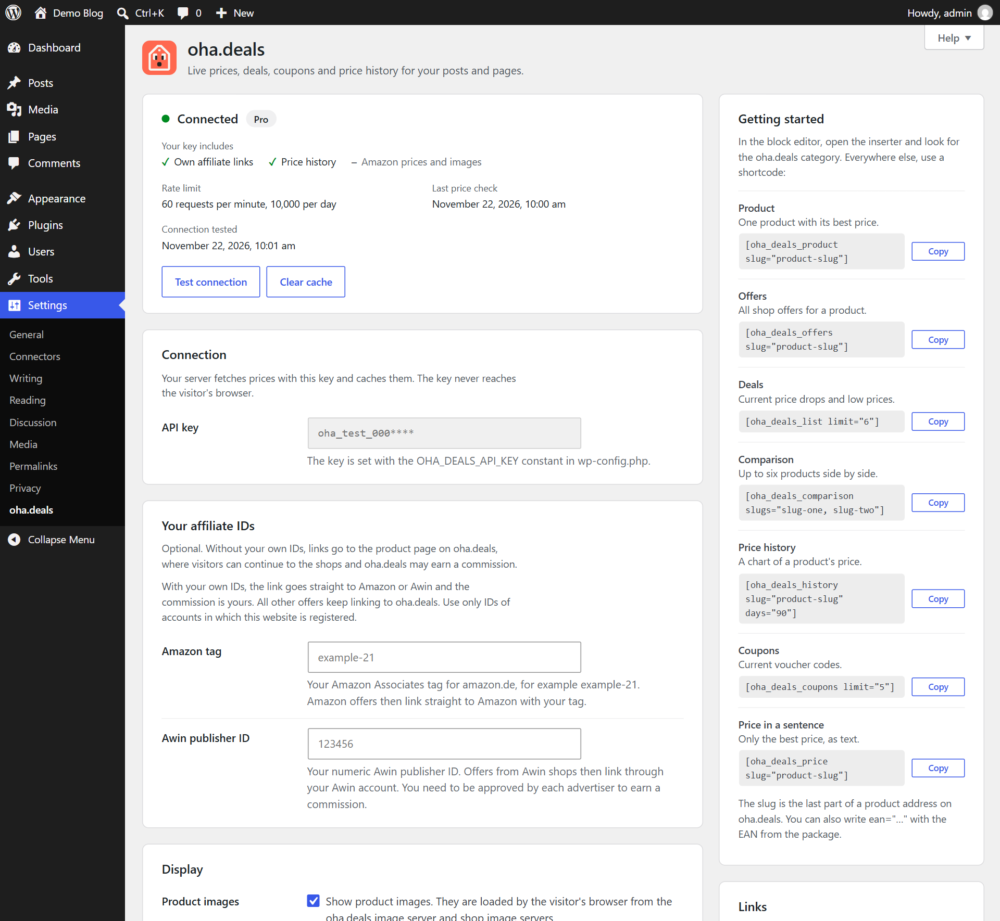

<p align="center">
  
</p>

# oha.deals for WordPress

[](https://github.com/oha-deals/wordpress-plugin/actions/workflows/ci.yml)


[](LICENSE)

Live prices, shop offers, comparison tables, deals, coupons and price history from [oha.deals](https://oha.deals) on
any WordPress site, as blocks, shortcodes, block bindings and PHP data.

| | |
|---|---|
|  |  |
| **Product** with best price, shop offers and an interactive price chart | **Comparison** of up to six products, or a numbered top list |
|  |  |
| **Deals**: current price drops and lowest prices | **Editor** with product search and live preview |
|  |  |
| **Coupons** with copy buttons | **Settings** with connection status and your own affiliate IDs |

<sub>Products, shops and prices in the screenshots are invented (see [demo/](demo)).</sub>

## Quick start

1. Download `oha-deals.zip` from the [latest release](https://github.com/oha-deals/wordpress-plugin/releases/latest) and
   install it under **Plugins → Add New → Upload Plugin**.
2. Go to **Settings → oha.deals**, enter your API key and click **Test connection**. Or define `OHA_DEALS_API_KEY` in
   `wp-config.php`. Ask for a key through the [contact form](https://oha.deals/kontakt).
3. Add a block from the **oha.deals** category, or use a shortcode.

Requires WordPress 6.6+ and PHP 7.4+.

## Blocks and shortcodes

| Block | Shortcode | Main attributes |
|---|---|---|
| Product | `[oha_deals_product]` | `slug` or `ean`, `layout` (card, compact, inline), `show_image`, `offers_limit` (0–10), `show_history`, `button_text` |
| Comparison | `[oha_deals_comparison]` | `slugs` (up to 6), `fields`, `orientation` (columns, rows), `highlight_best`, `numbered`, `title`, `button_text` |
| Offers | `[oha_deals_offers]` | `slug` or `ean`, `limit` (1–30), `show_shipping`, `include_used`, `show_title` |
| Deals | `[oha_deals_list]` | `mode` (all, drop, low), `category`, `sort` (percent, amount, price, new), `limit` (1–24), `columns` (1–4), `min_price`, `max_price` |
| Price history | `[oha_deals_history]` | `slug` or `ean`, `days` (30, 90, 180, 365), `height` |
| Coupons | `[oha_deals_coupons]` | `host`, `limit` (1–20) |
| – | `[oha_deals_price]` | `slug` or `ean`; only the best price, for use in a sentence |

```
[oha_deals_comparison slugs="product-one, product-two" fields="image,price,shop,specs"]
```

## Build your own tables and layouts

The API sends JSON; the plugin gives it to you in the form that fits:

- **Block bindings** (`oha-deals/product`): live values in core paragraph, heading, button and image blocks.
- **`oha_deals_query()`**: products, search results, deals, coupons and categories as plain PHP arrays.
- **Template overrides** in `<theme>/oha-deals/`.
- **WP-CLI**: `wp oha-deals product <slug> --format=json`, `wp oha-deals deals --format=csv`, `wp oha-deals status`,
  `wp oha-deals cache flush`.

Examples, data shapes and all hooks: **[docs/DEVELOPERS.md](docs/DEVELOPERS.md)**.

## Links and commissions

Without your own affiliate IDs, links lead to the product page on oha.deals; visitors can continue to the shops from
there, and oha.deals may earn a commission. With your own Amazon Associates tag or Awin publisher ID, links go straight
to Amazon or Awin with your ID and the commission is yours. A disclosure under each element says where its links lead.

## Privacy

Your server talks to the API; visitors do not. No cookies, no tracking, and the API key never reaches the browser.
Product images are loaded by the visitor's browser from oha.deals and shop image hosts, and can be turned off.

## Development

Node 20+, Composer, PHP 7.4+ and Docker (for [`wp-env`](https://developer.wordpress.org/block-editor/reference-guides/packages/packages-env/)).

```bash
npm ci && composer install
npm run build          # src/ → build/
npm run env:start      # local WordPress at http://localhost:8888

npm run lint:js && npm run lint:css && npm run test:js
composer lint          # PHPCS: WordPress-Extra, WordPress-Docs, PHPCompatibilityWP
composer analyse       # PHPStan level 8
npx wp-env run tests-cli --env-cwd=wp-content/plugins/oha-deals vendor/bin/phpunit
```

No key at hand? Copy [`demo/oha-deals-demo.php`](demo/oha-deals-demo.php) to `wp-content/mu-plugins/`: it answers the
API requests with invented products.

Design notes are in [docs/ARCHITECTURE.md](docs/ARCHITECTURE.md), how to contribute in [CONTRIBUTING.md](CONTRIBUTING.md).
Please report vulnerabilities privately, see [SECURITY.md](SECURITY.md).

## Licence

[GPL-2.0-or-later](LICENSE). "oha.deals" and its logo are brand names of oha.deals.
